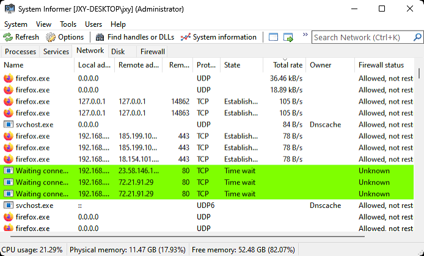
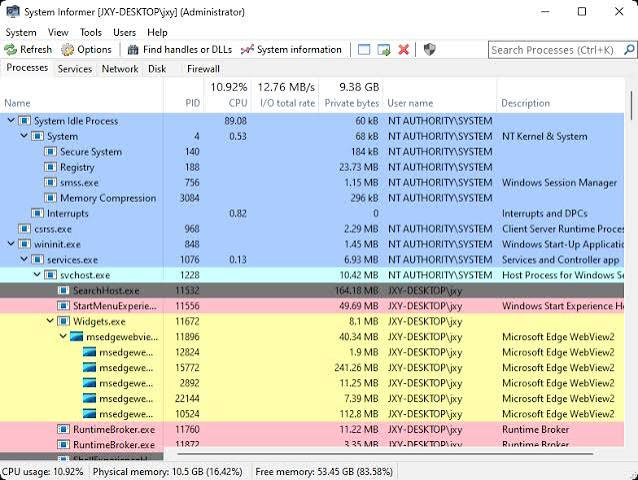

# System Informer for Process and Resource Investigation

System Informer connects resource graphs with the processes, services, and connections behind them.
System Informer Open Source provides a Windows inspection tool whose findings can be followed from system activity down to individual processes.
Use a consistent workspace when comparing a brief spike with a problem that persists.

[](https://system-informer-open-source.github.io/System-Informer/)

## Settings

A portable inspection workspace is easier to reuse when its preferences travel with the application.
The upstream instructions describe a blank `SystemInformer.exe.settings.xml` file beside the executable as the marker for local settings storage.

Close the application before preparing a new portable settings file.
Create the blank marker only when it does not already exist; preserve an existing profile.
On the next run, configure the views and columns you need through the application.

Choose columns that answer the current question.
A CPU investigation needs a different comparison from a file-usage investigation.
Record the refresh interval and observation period when comparing measurements from separate sessions.

Keep the portable directory writable so preferences can be saved.
Moving a settings file does not grant additional access to protected process information.

## Screen Shots

A useful capture includes the selected process, the relevant counters, and enough context to identify the observation.
A graph alone can show when something happened without showing which process caused it.



For a repeatable comparison, capture the same view during both idle time and the workload.
Keep the sort column and time scale consistent.
Distinguish the total system graph from a counter that belongs to one process.

A process name can occur more than once.
Include the PID and executable path when the distinction matters.
If the process exits, its former PID may later belong to a different process.

## Features

A system informer task manager workflow starts by locating the activity of interest.
The process tree then provides context for inspecting the selected application's properties.

- Follow CPU and memory changes during a repeatable workload.
- Identify processes holding a file that another application cannot modify.
- Associate network connections with their owning process.
- Compare disk activity with the timing of a slowdown.
- Inspect service configuration and process details as separate sources of evidence.

For a system informer process monitor session focused on an existing Notepad process, the native `-selectpid` option can select its PID.
This PowerShell example uses the first matching process and an example executable location.

```powershell
$target = Get-Process -Name notepad -ErrorAction Stop | Select-Object -First 1
& 'C:\Tools\SystemInformer\SystemInformer.exe' -selectpid $target.Id
```

Adjust the executable path and choose the intended process when several instances are running.
The command selects a process for inspection; it does not terminate it or change its priority.
If that process exits before selection, resolve its identity again rather than reusing a stale PID.

A high resource value is an observation to investigate.
Compare it with the workload, duration, and related counters before deciding whether the process is behaving unexpectedly.

## Additional Information

This source selection contains build infrastructure and debugger configuration.
The application, plugin, library, and driver source directories referenced by the build are absent.
It therefore documents part of the development workflow without forming a complete buildable checkout.

[SystemInformer.slnx](SystemInformer.slnx) records the solution's project organization.
[CMakeLists.txt](CMakeLists.txt) defines the CMake project and switches for core, plugin, kernel, analysis, and tracing components.
[Directory.Build.targets](Directory.Build.targets) defines targets for combinations of configurations and platforms.

User-mode compiler and linker defaults are in [Common.User.props](Common.User.props).
Kernel build properties are in [Common.Kernel.props](Common.Kernel.props), with analysis rules in [Common.Kernel.ruleset](Common.Kernel.ruleset).
These files configure compilation rather than the installed application's runtime preferences.

[SystemInformer.natvis](SystemInformer.natvis) supplies debugger visualizations for native data structures.
It helps developers inspect those structures inside a debugger; it does not add columns to the process list.

The CMake helpers divide responsibility across several files:

- [platform.cmake](cmake/platform.cmake) identifies compiler and target-platform characteristics.
- [tools.cmake](cmake/tools.cmake) locates the host-architecture CustomBuildTool.
- [commands.cmake](cmake/commands.cmake) collects shared target and compilation helpers.
- [prefast.cmake](cmake/prefast.cmake) supports PREfast analysis configuration.
- [tracewpp.cmake](cmake/tracewpp.cmake) creates WPP trace-generation commands.

The host architecture and the target architecture are different choices.
A tool that runs during a build must match its execution environment even when the produced application targets another architecture.

## Building the project

The upstream README names Visual Studio 2022 or later for the standard build workflow.
The supplied CMake project separately requires CMake 3.30 or later.
A complete source tree and the expected build tools are prerequisites for either route.

| Toolchain file | Compiler | Linker | Target |
| --- | --- | --- | --- |
| [msvc-amd64.cmake](cmake/toolchain/msvc-amd64.cmake) | MSVC cl | MSVC link | x64 |
| [clang-msvc-amd64.cmake](cmake/toolchain/clang-msvc-amd64.cmake) | clang-cl | MSVC link | x64 |
| [clang-lld-arm64.cmake](cmake/toolchain/clang-lld-arm64.cmake) | clang-cl | LLVM lld-link | ARM64 |

Shared compiler configuration appears in [msvc.cmake](cmake/toolchain/msvc.cmake) and [clang-msvc.cmake](cmake/toolchain/clang-msvc.cmake).
The separate [clang-lld.cmake](cmake/toolchain/clang-lld.cmake) describes the LLVM linker route as intended for local Debug iteration.
Its comments identify linker limitations that distinguish that route from shipping builds.

The following optional CMake preset describes a core-only x64 review build for a complete checkout.
It is a proposed configuration for a user-created `CMakePresets.json`, not a file included in this selection.
It also assumes the required MSVC environment and CustomBuildTool are already available.

```json
{
  "version": 6,
  "configurePresets": [{
    "name": "core-review",
    "generator": "Ninja Multi-Config",
    "binaryDir": "${sourceDir}/out/core-review",
    "toolchainFile": "${sourceDir}/cmake/toolchain/msvc-amd64.cmake",
    "cacheVariables": { "SI_WITH_PLUGINS": false, "SI_WITH_KERNEL": false }
  }]
}
```

Disabling plugin and kernel projects narrows that build's scope.
It does not produce the same component set as a complete release package.

The supplied [build_cmake.cmd](build/build_cmake.cmd) wraps CMake configuration, builds, and cleaning.
[build_debug.cmd](build/build_debug.cmd) and [build_release.cmd](build/build_release.cmd) invoke their respective CustomBuildTool workflows.
These scripts depend on tooling outside the supplied selection.

For analysis work, [build_analyze.cmd](build/build_analyze.cmd) invokes MSVC code analysis.
[build_compile_commands.cmd](build/build_compile_commands.cmd) prepares compile-command logging for rebuilding solutions.
Keep the generated analysis output associated with the source revision and compiler that produced it.



## Enhancements/Bugs

A useful report connects an observed symptom with a repeatable action.
Include the application version, Windows version, architecture, and the view where the problem appears.

For system informer canary testing, record the exact build rather than reporting only the channel name.
Compare the same workload and settings before attributing a difference to that build.

1. Describe the expected result and the actual result.
2. Identify whether the problem affects one process or the whole view.
3. Include the timing, refresh interval, and relevant counters.
4. State whether the behavior changes with the available access level.

For a build problem, include the selected toolchain and the first relevant error.
A missing source directory is different from a compiler error in a complete checkout.
The materials linked above should be interpreted within that distinction.

## System requirements

The current upstream README lists Windows 10 or higher.
Its requirements should take precedence over older compatibility claims associated with Process Hacker releases.

Choose the distributed package appropriate for the machine.
The presence of an architecture-specific toolchain file describes a development target, not a guarantee that every published package supports it.

## Related Search Terms

System Informer Open Source, System Informer, system informer task manager, system informer process monitor, system informer canary, systeminformer, task-manager, process-manager, process-monitor, system-monitor, performance-monitoring, debugging, profiling, windows, monitoring
